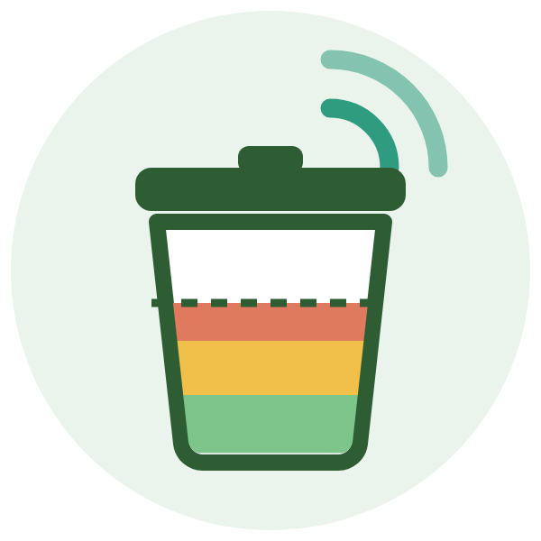
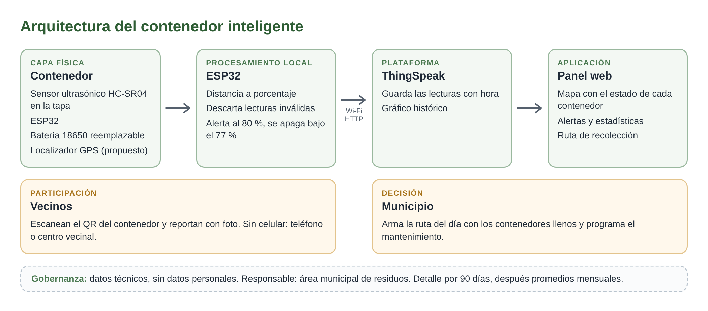

# Contenedores inteligentes

Proyecto Final Integrador de **Ciudades Inteligentes para el Desarrollo** (UCA, Ingeniería en Informática).
Comisión 15FN. Integrantes: Joaquín Mantel, Nicolás Lucini y Luis Guillermo Ivanoff.

## El problema

Los contenedores de residuos se desbordan porque la recolección sigue rutas y horarios fijos.
El camión pasa por contenedores vacíos y llega tarde a los llenos.
Proponemos medir el llenado de cada contenedor y armar la ruta del día según la demanda real.

## Cómo está armado

1. **Simulador (Wokwi):** un ESP32 con un sensor ultrasónico HC-SR04 mide la distancia hasta la basura y calcula el porcentaje de llenado. La alerta se activa al 80 % y se apaga por debajo del 77 %. Un potenciómetro simula la batería.
2. **Plataforma (ThingSpeak):** el ESP32 envía el llenado y la batería por HTTP al canal público 3486377.
3. **Panel web:** muestra los contenedores en un mapa, las alertas, estadísticas, la ruta de recolección y una vista para vecinos con QR y reportes con foto.

## Links

- Panel publicado: https://joacomantel.github.io/contenedores/
- Datos en ThingSpeak: https://thingspeak.mathworks.com/channels/3486377
- Simulación en Wokwi: https://wokwi.com/projects/476161721716272129

## Contenido del repositorio

| Archivo | Qué es |
|---|---|
| `index.html` | Código del panel web (HTML, CSS y JavaScript en un solo archivo) |
| `simulador/sketch.ino` | Código del ESP32 (Arduino/C++): medición, alerta, batería y envío a ThingSpeak |
| `simulador/diagram.json` | Circuito de Wokwi: ESP32, sensor HC-SR04 y potenciómetro que simula la batería |
| `docs/Proyecto_Final_Integrador_Contenedores_Inteligentes.pdf` | Entrega final en PDF |
| `docs/Proyecto_Final_Integrador_Ciudades_Inteligentes.html` | Formulario del trabajo integrador, con las respuestas cargadas |
| `docs/Proyecto_Final_Integrador_respaldo.json` | Respaldo JSON del formulario (se importa con "Importar JSON") |
| `docs/Informe_Contenedor_Inteligente.docx` | Informe del proyecto |
| `docs/Diagrama_arquitectura.png` | Diagrama de arquitectura por capas |

## Cómo probarlo

- **Panel:** abrir el link publicado. Si se abre `index.html` desde la computadora, el mapa real no carga y el panel muestra un mapa esquemático.
- **Simulador:** abrir el link de Wokwi y tocar "Play". Con el sensor ultrasónico se cambia la distancia: a 30 cm marca 25 % sin alerta; a 5 cm marca 87,5 % y dispara la alerta. Si se desconecta el cable ECHO, registra "SIN DATO" sin alertas falsas.

## Sobre el código del simulador

En la copia de este repositorio la clave de escritura de ThingSpeak se reemplazó por `TU_WRITE_API_KEY`, para no publicarla. El proyecto en Wokwi tiene la clave real y envía los datos al canal 3486377.

Conexiones: sensor HC-SR04 con TRIG en el pin 5 y ECHO en el pin 18; potenciómetro en el pin 34.

## Aclaración

Los datos del panel son de ejemplo, salvo el Contenedor 01, que muestra en vivo lo que envía el simulador. El impacto (menos desbordes y menos kilómetros) es una hipótesis: para comprobarlo proponemos un piloto de dos meses.
